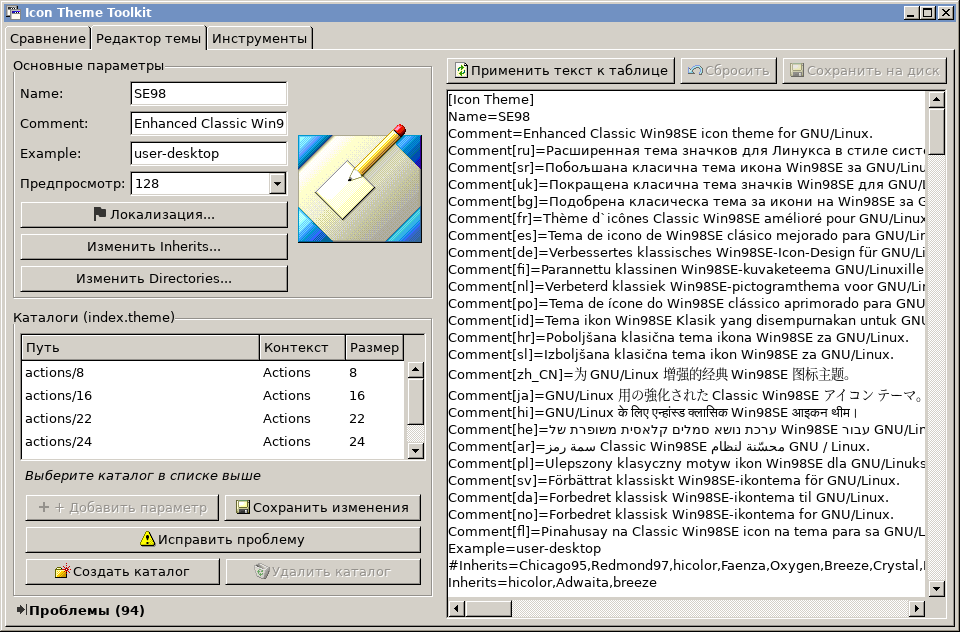
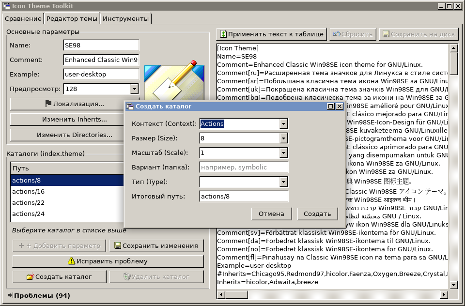
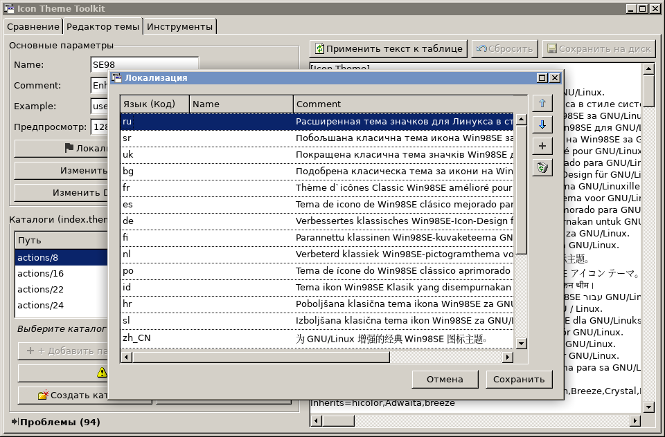
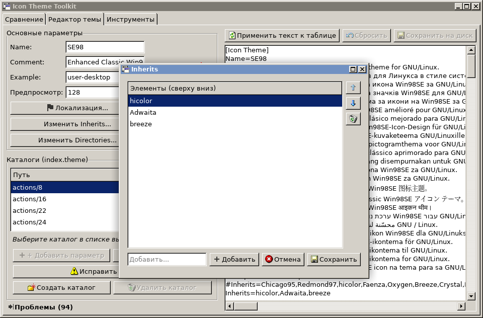
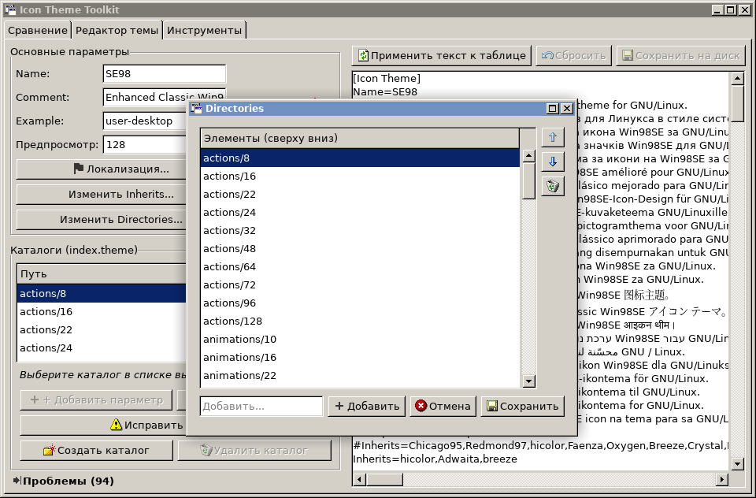

# icon-theme-toolkit
An ambitious project for an integrated editing toolkit of Linux icon themes. Currently in Russian.

[RU] Амбициозный проект полноцнного комбайна по редактированию темы значков на Linux. Пока что только на руссокм.

Скриншоты (screenshots):

